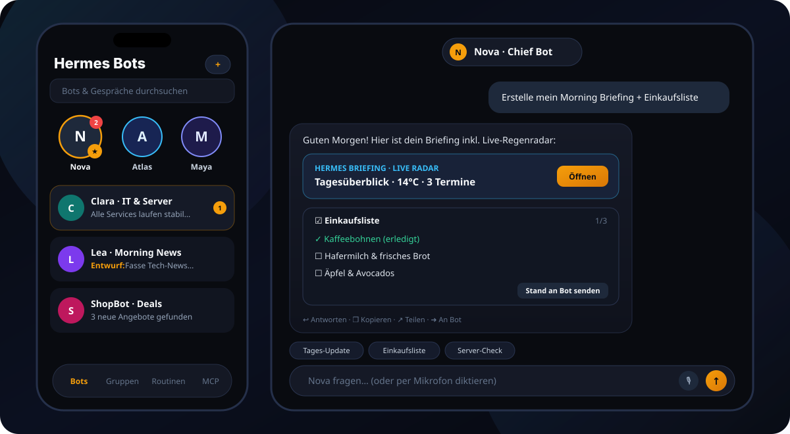
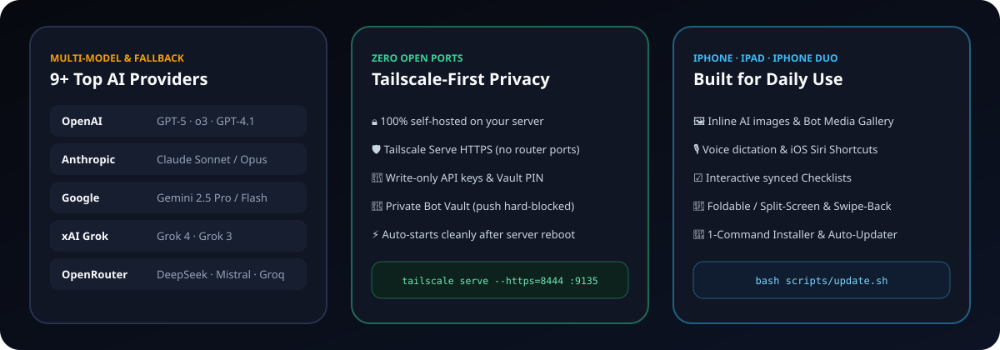

<div align="center">
  
  <h1>Hermes Bots</h1>
  <p><strong>Private, mobile PWA &amp; BFF-Oberfläche für deinen selbstgehosteten Hermes Agent</strong></p>

  <p>
    <a href="README.md"><strong>🇬🇧 Read English Version</strong></a> ·
    <a href="#schnellinstallation">⚡ 1-Zeilen-Installer</a> ·
    <a href="#tailscale-empfohlen">🔒 Tailscale-Sicherheit</a> ·
    <a href="#unterstützte-ki-anbieter">🤖 KI-Anbieter</a> ·
    <a href="#auto-updater">🔄 Auto-Updater</a>
  </p>

  <p>
    
    
    
    
  </p>
</div>

<p align="center">
  
</p>

---

## Warum Hermes Bots?

**Hermes Bots** macht aus deinem selbstgehosteten **Hermes Agent** einen schnellen, nativen Mobile-Messenger für iPhone, iPad, iPhone Duo / Foldables und Desktop – während **100 % deiner Chats, Bots, Routinen, Bilder und API-Keys privat auf deinem eigenen Server bleiben**.

<p align="center">
  
</p>

### Highlights
- **Chef-Bot &amp; angepinnte Bots:** Markiere deinen Haupt-Assistenten (mit ★ Chef-Badge) und Lieblings-Bots ganz oben – automatisch über alle Geräte synchronisiert.
- **Direkte Inline-Medien &amp; Galerie:** Von Bots erzeugte Bilder (`MEDIA:/...`), Audio, Video und Dateien erscheinen direkt im Chat – mit **Bild kopieren**, nativem iOS **Teilen / In Fotos sichern** und einer **Medien-Galerie pro Bot**.
- **Interaktive Briefings &amp; Checklisten:** Gesandboxte HTML-Briefings (Wetter, News, Live-Regenradar) sowie abhakbare **Einkaufs- &amp; Aufgaben-Checklisten** (`[CHECKLIST: ...]`), die serverseitig gespeichert werden.
- **Spracheingabe &amp; iOS Kurzbefehle / Siri:** Direkt im Chat per Mikrofon diktieren oder deine Bots per **„Hey Siri“**, Action-Button oder CarPlay ansprechen.
- **Privater Bereich (Bot-Tresor):** Isoliere private Bots hinter einer serverseitig gehashten PIN – unsichtbar in der Hauptliste, ausgeschlossen aus Briefings und **serverseitig hart gegen Web-Push &amp; Siri gesperrt**.
- **Feinsteuerbare Push-Benachrichtigungen:** Master-Schalter + Einzelschalter pro Bot, Ungelesen-Zähler, In-App-Toast und App-Icon-Badge.
- **iPhone- &amp; iPhone-Duo-Komfort:** Wischen vom linken Rand zum Zurückgehen, Pull-to-Refresh, automatische Entwürfe pro Bot, Suche direkt im Chat, Antworten/Zitieren, konfigurierbare 1-Tipp-Schnellaktionen und 2-Spalten-Split-Screen auf breiten/faltbaren Displays.

---

## ⚡ Schnellinstallation

Installiere Hermes Bots auf deinem Linux-/macOS-Server (auf dem Hermes Agent läuft) mit einem einzigen Befehl:

```bash
curl -fsSL https://raw.githubusercontent.com/Strugglechen1337/Hermes-Bot/main/scripts/install.sh | bash
```

Was der Installer automatisch erledigt:
1. Prüft Node.js 20+ und Git.
2. Klont Hermes Bots nach `~/hermes-bots` (oder aktualisiert bestehende Installationen, ohne `.env` oder `.data/` anzufassen).
3. Baut Web-PWA und Node-BFF-Server (`npm ci && npm run build`).
4. Bindet strikt an `127.0.0.1:9135` und richtet einen `systemd --user`-Dienst inkl. `loginctl enable-linger` ein, sodass **Hermes Bots nach jedem Server-Neustart automatisch wieder hochfährt**.

---

## 🔒 Tailscale empfohlen (Sicherste Einrichtung)

Für maximale Sicherheit empfehlen wir ausdrücklich **[Tailscale](https://tailscale.com/)** statt offener Router-Ports:

```bash
tailscale serve --bg --https=8444 http://127.0.0.1:9135
```

**Warum Tailscale ideal ist:**
- **Keine offenen Ports im Router:** Dein Server bleibt im öffentlichen Internet komplett unsichtbar.
- **Automatisches gültiges HTTPS:** Zwingend nötig für iOS-Home-Bildschirm-PWAs, Web-Push und Mikrofon-Zugriff.
- **Zugriff nur über dein privates Tailnet:** Nur deine eigenen angemeldeten Geräte (iPhone, iPad, PC/Mac) erreichen die Oberfläche.
- **Überlebt Neustarts:** `tailscale serve --bg` bleibt nach jedem Server-Reboot automatisch aktiv.

Öffne danach deine Adresse `https://<dein-server>.ts.net:8444` in **Safari auf dem iPhone** → **Teilen** → **„Zum Home-Bildschirm“**.

---

## 🤖 Unterstützte KI-Anbieter

Verbinde die meistgenutzten KI-Anbieter direkt in der App unter **Konto → KI-Anbieter &amp; API-Keys** (Write-Only in die geschützte `.env` auf deinem Server – Keys verlassen deinen Server nie zurück zum Browser):

| Anbieter | Env-Variable | Beliebte Modelle |
| --- | --- | --- |
| **OpenAI** | `OPENAI_API_KEY` | GPT-5, GPT-4.1, o3, o4-mini |
| **Anthropic Claude** | `ANTHROPIC_API_KEY` | Claude Sonnet 4.5, Claude Opus 4 |
| **Google Gemini** | `GEMINI_API_KEY` | Gemini 2.5 Pro, Gemini 2.5 Flash |
| **xAI Grok** | `XAI_API_KEY` | Grok 4, Grok 3, Grok Vision |
| **OpenRouter** | `OPENROUTER_API_KEY` | 200+ Modelle über einen Key |
| **DeepSeek** | `DEEPSEEK_API_KEY` | DeepSeek R1, DeepSeek V3 |
| **Mistral AI** | `MISTRAL_API_KEY` | Mistral Large, Codestral |
| **Groq** | `GROQ_API_KEY` | Ultra-schnelle Llama 4 &amp; Qwen |
| **Ollama (Lokal)** | `OLLAMA_BASE_URL` | 100 % lokale Modelle auf deinem Server |

Jeder Bot kann sein eigenes Modell plus automatischen Fallback (z. B. Anthropic-Fallback bei Limits) nutzen.

---

## 🔄 Auto-Updater

- **Update-Prüfung in der App:** Unter **Konto → Prüfen** siehst du sofort, ob eine neuere GitHub-Version verfügbar ist.
- **Sicheres 1-Befehl-Update** (lässt `.env`, `.data/` und alle Hermes-Profile unberührt):

```bash
cd ~/hermes-bots && bash scripts/update.sh
```

---

## 🎙️ iOS Kurzbefehle / Siri einrichten

1. Öffne in Hermes Bots **Konto → iOS Kurzbefehle / Siri → Einrichten** und kopiere den **Auth-Header**.
2. Lege in der Apple-App **Kurzbefehle** die Aktion **Inhalte von URL abrufen** an:
   - **URL:** `https://<dein-tailnet-host>:8444/api/pocket/shortcut`
   - **Methode:** `POST`
   - **Header:** `Authorization` → kopierten `Bearer ...`-Header einfügen
   - **JSON-Body:** `{"bot": "nova-chief", "text": "<Diktierter Text>"}`
3. Optional danach **Text sprechen** mit dem Feld `reply` – fertig!

---

## Entwicklung &amp; Tests

```bash
npm install
npm run typecheck
npm test
npm run build
```

## Sicherheitsmodell
- Hermes Agent bleibt die alleinige Quelle für Login, Bots, Chats, Gruppen und Routinen.
- Alle `/api/pocket/*`-Endpunkte prüfen die Hermes-Session (bzw. Constant-Time-Bearer-Token für `/api/pocket/shortcut`), erzwingen Same-Origin bei Schreibzugriffen und sperren `.env`, `config.yaml`, Datenbanken, Logs und Tresore hart aus.
- Briefings laufen in CSP-gesandboxten iframes ohne `allow-same-origin`.
