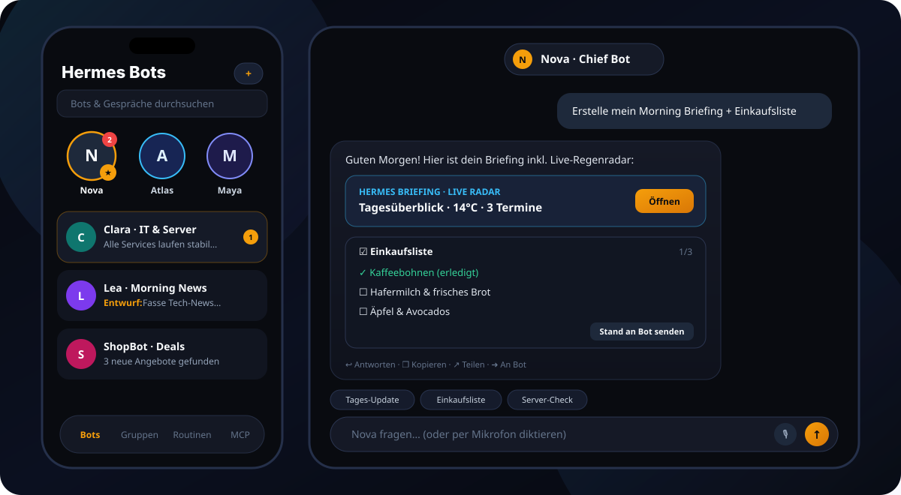

<div align="center">
  
  <h1>Hermes Bots</h1>
  <p><strong>Private, mobile-first PWA &amp; BFF for your self-hosted Hermes Agent</strong></p>

  <p>
    <a href="README.de.md"><strong>🇩🇪 Deutsche Version lesen</strong></a> ·
    <a href="#quick-install">⚡ 1-Line Installer</a> ·
    <a href="#tailscale-recommended">🔒 Tailscale Security</a> ·
    <a href="#supported-ai-providers">🤖 AI Providers</a> ·
    <a href="#auto-updater">🔄 Auto-Updater</a>
  </p>

  <p>
    
    
    
    
  </p>
</div>

<p align="center">
  
</p>

---

## Why Hermes Bots?

**Hermes Bots** turns your self-hosted **Hermes Agent** into a fast, native-feeling mobile messenger for iPhone, iPad, Foldable / iPhone Duo, and desktop — while keeping **100% of your chats, bots, routines, media, and API keys on your own server**.

<p align="center">
  
</p>

### Highlights
- **Chief Bot &amp; Pinned Showcase:** Pin your primary coordinator bot (with ★ Chief badge) and favorite bots right at the top, synced across devices.
- **Inline Bot Media &amp; Gallery:** Bot-generated images (`MEDIA:/...`), audio, video, and files render directly inside chat bubbles — with 1-tap **Copy Image**, native iOS **Share / Save to Photos**, and a per-bot **Media Gallery**.
- **Interactive Briefings &amp; Checklists:** Sandboxed HTML briefings (weather, news, live rain radar) plus tappable **shopping &amp; to-do checklists** (`[CHECKLIST: ...]`) synced on your server.
- **Voice Dictation &amp; iOS Siri Shortcuts:** Speak directly into the composer or trigger your bots via **“Hey Siri”**, iPhone Action Button, or CarPlay using a dedicated Bearer token.
- **Private Bot Vault:** Isolate sensitive bots behind a server-synced PIN hash — hidden from the main list, excluded from Briefings, and **hard-blocked from Web Push &amp; Siri on the server**.
- **Granular Web Push:** Master toggle + per-bot push switches, unread counters, floating in-app toasts, and iOS Home Screen badges.
- **iPhone &amp; iPhone Duo Ready:** Edge swipe-back gesture, pull-to-refresh, per-bot draft auto-save, in-chat search with jump-to-match, message quote-reply, and adaptive 2-column split-screen layout for wide/foldable screens.

---

## ⚡ Quick Install

Install Hermes Bots on your Linux/macOS server (where Hermes Agent is running) with one command:

```bash
curl -fsSL https://raw.githubusercontent.com/Strugglechen1337/Hermes-Bot/main/scripts/install.sh | bash
```

What the installer does:
1. Checks Node.js 20+ and Git.
2. Clones Hermes Bots into `~/hermes-bots` (or updates without touching `.env` / `.data/`).
3. Builds the web PWA and Node BFF server (`npm ci && npm run build`).
4. Binds strictly to `127.0.0.1:9135` and installs a `systemd --user` service with lingering enabled so **Hermes Bots auto-starts cleanly after server reboots**.

---

## 🔒 Tailscale Recommended (Best Security Setup)

We **strongly recommend running Hermes Bots behind [Tailscale](https://tailscale.com/)** instead of exposing ports to the public internet:

```bash
tailscale serve --bg --https=8444 http://127.0.0.1:9135
```

**Why Tailscale is the best fit:**
- **Zero open router ports:** Your server stays completely invisible to the public internet.
- **Automatic valid HTTPS:** Required by iOS Safari for Home Screen PWAs, Web Push notifications, and Microphone access.
- **Private tailnet access only:** Only your own signed-in devices (iPhone, iPad, laptop) can reach the URL.
- **Survives reboots:** `tailscale serve --bg` persists automatically across server restarts.

Then open your `https://<your-machine>.ts.net:8444` link in **Safari on iPhone** → **Share** → **Add to Home Screen**.

---

## 🤖 Supported AI Providers

Connect the most popular AI providers directly from **Account → AI Providers &amp; API Keys** (write-only into your server's protected `.env` — keys are never stored in the browser):

| Provider | Env Variable | Popular Models |
| --- | --- | --- |
| **OpenAI** | `OPENAI_API_KEY` | GPT-5, GPT-4.1, o3, o4-mini |
| **Anthropic Claude** | `ANTHROPIC_API_KEY` | Claude Sonnet 4.5, Claude Opus 4 |
| **Google Gemini** | `GEMINI_API_KEY` | Gemini 2.5 Pro, Gemini 2.5 Flash |
| **xAI Grok** | `XAI_API_KEY` | Grok 4, Grok 3, Grok Vision |
| **OpenRouter** | `OPENROUTER_API_KEY` | 200+ models via one API key |
| **DeepSeek** | `DEEPSEEK_API_KEY` | DeepSeek R1, DeepSeek V3 |
| **Mistral AI** | `MISTRAL_API_KEY` | Mistral Large, Codestral |
| **Groq** | `GROQ_API_KEY` | Ultra-fast Llama 4 &amp; Qwen |
| **Ollama (Local)** | `OLLAMA_BASE_URL` | 100% local models on your own hardware |

Every bot can use its own model + automatic fallback provider (e.g. Anthropic fallback when rate limits hit).

---

## 🔄 Auto-Updater

- **In-App Check:** Open **Account → Check for Updates** to compare your installed version against the latest GitHub Release.
- **One-Command Safe Update** (never touches `.env`, `.data/`, or Hermes profiles):

```bash
cd ~/hermes-bots && bash scripts/update.sh
```

---

## 🎙️ iOS Shortcuts / Siri Setup

1. In Hermes Bots, open **Account → iOS Kurzbefehle / Siri → Setup** and copy the **Auth-Header**.
2. In the Apple **Shortcuts** app, add **Get Contents of URL**:
   - **URL:** `https://<your-tailnet-host>:8444/api/pocket/shortcut`
   - **Method:** `POST`
   - **Header:** `Authorization` → paste the copied `Bearer ...` header
   - **JSON Body:** `{"bot": "nova-chief", "text": "<Dictated Text>"}`
3. Add **Speak Text** on the `reply` field — now you can ask your bots hands-free via Siri!

---

## Development &amp; Tests

```bash
npm install
npm run typecheck
npm test
npm run build
```

## Security Model
- Hermes Agent remains the single source of truth for authentication, bots, sessions, groups, and routines.
- All BFF endpoints (`/api/pocket/*`) enforce Hermes session cookies (or dedicated constant-time Bearer token for `/api/pocket/shortcut`), strict Same-Origin checks on mutations, and path allowlists blocking `.env`, `config.yaml`, databases, logs, and vaults.
- Briefings render inside CSP-sandboxed iframes without `allow-same-origin`.
